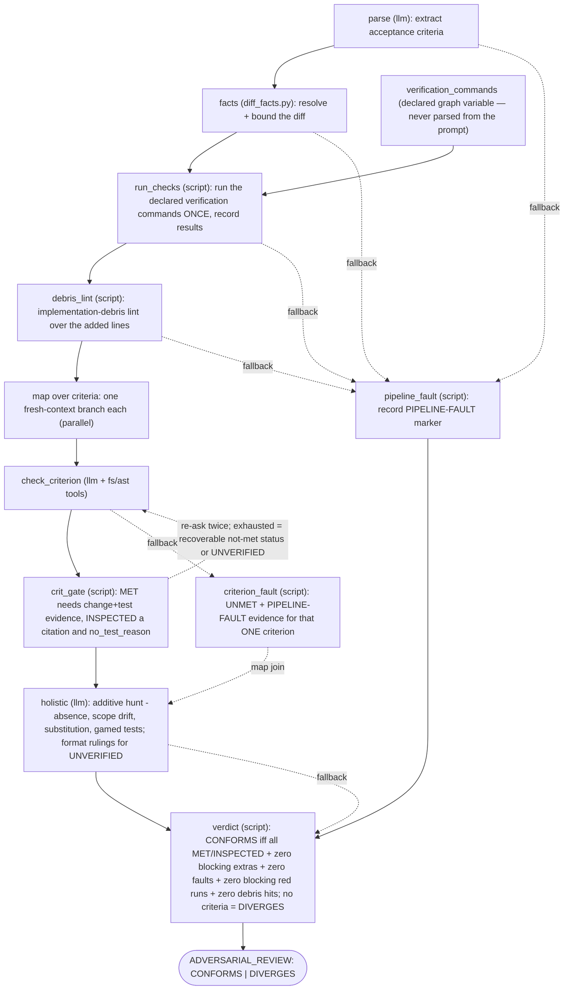

# Adversary

> [!IMPORTANT]
> **v2: now a GRAPH agent.** The plan's acceptance criteria are extracted into a list and the graph
> fans out ONE fresh-context verification branch per criterion — partial coverage ("checked 8 of 12")
> is structurally impossible. Each verdict passes a deterministic contract gate (MET requires
> evidence including a proving test; INSPECTED, met by inspection, is only for a criterion no test
> could prove and needs a file:line citation plus the reason no test applies), an additive holistic
> pass hunts absence/scope-drift/substitution/gamed-tests, and the CONFORMS/DIVERGES sentinel is
> computed by a script (missing plan = DIVERGES, fail-closed). The conformance doctrine below is
> structurally enforced: CONFORMS requires every criterion MET or INSPECTED + zero blocking holistic
> complaints + zero pipeline faults + zero red verification runs that did not already fail on the
> diff base (exit!=0/timeout, or a runner error when commands were declared), apart from advisory
> red runs (a criterion states a pass condition other than exit 0, or the red exists only in the
> uncommitted tree).


An **adversarial plan-conformance reviewer**. Where [`code-reviewer`](../code-reviewer/README.md)
asks *"is this code good?"*, `adversary` asks a different, harder question:

> **"Is this the code the plan asked for — all of it, and only it?"**

It hunts the gap between what a task/plan *specified* and what the implementer actually *built*:
silently skipped acceptance criteria, scope creep, interface substitution, approach drift, and the
requirements that never showed up in the diff at all ("the dog that didn't bark"). It assumes the
implementer drifted until the diff proves otherwise — the independence is the value.

## Why it's separate from `code-reviewer`

| | `code-reviewer` | `adversary` |
|---|---|---|
| Question | Is the code correct/clean/safe? | Does the code match the plan? |
| Input | The diff | The diff **+ the plan's acceptance criteria** |
| Blind spot it covers | slop, bugs, coupling, footguns | skipped criteria, scope drift, contract breakage |
| Output | severity-tagged findings (🔴🟡🟢) | a blocking verdict: `CONFORMS` / `DIVERGES` |

They are **complementary passes**, not substitutes. `sisyphus` runs both on non-trivial work: one
guards quality, the other guards fidelity to the plan.

## Verdict (blocking)

The agent ends every review with one sentinel:

```
ADVERSARIAL_REVIEW: CONFORMS
Criteria: N/N met (K test-proven, J by inspection).
Debris: clean (N added line(s) scanned)
```

CONFORMS is deterministic: every criterion MET or INSPECTED + zero blocking holistic complaints +
zero pipeline faults + zero red verification runs that did not already fail on the diff base
(exit!=0/timeout, or a runner error when commands were declared), apart from the advisory red runs
described below.
Zero implementation-debris hits from the mechanical `debris_lint` stage are required as well;
the `Debris:` line echoes the lint's summary as evidence that it ran.

- A red run's record carries a `baseline`: the command is run again in a temporary detached
  worktree at the diff base (`diff_base`, resolved by `diff_facts`), and the two outputs are
  compared with the coder agent's `gate_lib.sh` helpers, by the same rule as its verify_tests gate.
  The worktree is added with the user's git hooks disabled and is removed on normal exit.
  A base run that completed (not timed out, not killed by a signal) is saved with its full output
  as `$(git rev-parse --git-path coyote-baselines)/adversary-<key>.json`, keyed by the base tree,
  subdirectory, command, build lock prefix and per-command timeout; later reviews of the same
  base compare against it without running the command again, and add the worktree only for
  commands with no saved run. A flaky base keeps the one sample saved; delete the file to retake it.
  `pre-existing` failures are listed under `Pre-existing failures (not blocking):`; `regression`
  and `not-run` (no diff base, deadline spent, worktree or helper failure, the command timed out
  here or on the base) block, and the complaint names the outcome.
- Before the first declared command runs, the runner reads `git status --porcelain`. When it
  lists anything, a snapshot commit of that pre-run tree (HEAD plus every tracked and untracked
  file that is not ignored) is built through a temporary index, so the real index and refs are
  untouched; its objects stay unreferenced in the repository's object database. After the commands
  run, a dirty live tree is written the same way and its tree id compared with the pre-run one;
  on a clean tree `git status --porcelain` is read again. When the tree changed, no red run gets
  `tree-state` and each note ends `the declared commands modified the tree`; when the dirty tree
  cannot be written again, each note ends `candidate tree dirty, whether the declared commands
  modified it is unknown`. When HEAD is not the diff base (or either cannot be resolved), the
  uncommitted tree is not the whole change: nothing is rerun and each note ends `candidate tree
  dirty beside commits since the diff base`. A run that commits some work and leaves the rest
  uncommitted therefore gets no `tree-state` release (a false block, never a false pass), so
  commit before review or review the worktree spec. Otherwise, on a dirty tree, each red command held to exit 0 (a stated condition, such as
  `prints nothing`, is never rerun) that neither timed out nor was killed by a signal (exit 128
  or above) runs once more, inside the same deadline, in a detached worktree of the pre-run snapshot. A
  command that exits 0 there gets baseline `tree-state`: it is red only because the change is
  uncommitted. Any other snapshot outcome keeps the live run's classification against the base,
  and its note ends `candidate tree dirty`. When `core.sparseCheckout` is true, a dirty tree
  takes no snapshot and the note ends `candidate tree dirty`. When `git status` fails, no
  snapshot is taken and the note ends `candidate tree state unknown`. Snapshot runs are never
  saved to `coyote-baselines`.
- Each run record carries a `pass_condition`. A criterion or request line names a command only
  through a backticked span equal to it (whitespace and quote characters normalised). The
  condition is `stated` when no naming line says the command passes or exits 0 and the clause
  after at least one naming span makes the command the subject of another condition: an optional
  modal ("must", "should", "is expected to"), then the condition ("prints nothing", "returns no
  output", "is empty", "does not exist", "exits 1"); otherwise `exit 0`. A clause saying what the
  command checks ("checks the CLI exits 1", "covers the absent-file case") states nothing. That
  clause ends at the next backticked span, a `.` or `;` followed by whitespace, or the end of the
  line.
  A command named nowhere (the caller's build/test/lint contract), only in passing
  ("Verification commands: `x`") or inside a longer span is held to exit 0. The verdict
  recomputes it from the criteria and the request, never from the record. A red run held to exit
  0 blocks as above, and so does one that timed out or was killed by a signal (exit 128 or
  above), whatever its baseline. A red run whose condition parsed criteria state blocks unless
  every criterion naming it ends MET or INSPECTED, and its complaint names those criteria and
  statuses. A red run whose
  condition only the request states blocks, and its complaint quotes the request line. A stated
  run that exited 0 is gated the same way and is never a green run. A stated
  run whose criteria are met is listed under `Advisory red runs (not blocking):`, and so is a
  `tree-state` run held to exit 0 unless a criterion naming it ends neither MET nor INSPECTED (one about the
  uncommitted tree itself, say), which blocks and names those criteria and statuses.
- With a non-empty `carried_failures` (below), each red run held to exit 0 that exited below 128
  and whose baseline is neither `pre-existing` nor `tree-state` has its full output parsed by the
  shared `.shared/failure_locations.py`, which resolves each failure to the repo paths git lists
  (a directory ends in `/`). The record gains `carried`: `all`, `matched`, `new` and `unlocated`.
  `all` is true only when the output was not trimmed, is under 4 MB, locates at least one failure,
  has no failure line that names no repo path, and every located failure's paths exactly equal a
  carried item's; a failing file inside a carried directory is a new failure. Matching is per
  location (a file, or a directory when the output names only that), so a further failure at a
  carried location is not told apart from the carried one; the owner's own gate still has to see
  that location green. A run whose
  `carried.all` is true is listed under `Advisory red runs (not blocking):` as every failure being
  one the caller declared carried, grouped by owner, unless a criterion naming the command ends
  neither MET nor INSPECTED, which blocks and names those criteria and statuses. A run only partly
  carried blocks as a regression, and its complaint adds the failures not declared carried and the
  count of unlocated failure lines. When the parser cannot be loaded, git cannot list the files
  or the run's deadline is spent, the record gets a `carried_note` instead, rendered as an
  advisory line, and blocks as if nothing were carried.
- A command the runner's deadline skipped renders as `[NOT RUN]` and does not block by itself; the
  criterion checks judge the criteria it covers like an execution criterion no recorded run covers
  (below), naming the command and that it was skipped for time. The report's `Criteria:` line
  counts the skipped commands, so a CONFORMS that rests on them is visible.
- Holistic complaints carry a required `blocking` flag. `blocking: false` complaints (for example
  spec-endorsed waste, whose criterion stays MET) are listed under
  `Non-blocking holistic complaints:` in either verdict.
- The changed files under the configured `debris_exclude` dirs reach the criterion checks and the
  holistic pass as `bookkeeping_files`, the run's own planning files (deleted ones included); the
  diff and the changed-file list still include them. A scope-drift complaint (kind containing
  `scope drift` or `out-of-scope`) whose every location path lies under those dirs is listed as
  non-blocking too, marked `scope drift confined to the run's planning files`. Other kinds, and
  locations that also name a file outside them (a path, a name with a `:N`, `:LN` or `#LN` anchor,
  or the basename of a changed file outside them) or a path that escapes them with `..`, still
  block; with no `debris_exclude` nothing is demoted. The demotion keys only on the scope-drift
  kind and a location confined to the planning dirs, so an edit there that weakens acceptance
  criteria or verification commands is expected to be flagged under its own kind.
- INSPECTED criteria are listed under `Inspected, not test-proven:` with their evidence and
  `no_test_reason`. That includes an execution criterion no recorded run covers (none declared, a
  runner error, or declared commands that cover only part of it) which the criterion check judged
  satisfied from the diff and the working tree: its `no_test_reason` begins
  `ENVIRONMENT: declare <command> via the verification_commands variable`, and the contract gate
  rejects an `ENVIRONMENT:` reason with nothing after it. A covering red run stays UNMET whatever the
  inspection shows.
- CONFORMS on such an `ENVIRONMENT:` INSPECTED criterion requires at least one green recorded run
  (exit 0, not skipped). With nothing executed (a `none declared` or runner-error marker, an empty
  list, or only red or skipped records) the verdict counts it as PARTIAL, with a complaint saying
  nothing was executed and naming the command to declare.
- `diff_facts` also records `git_facts`, which both the criterion checks and the holistic pass
  see: HEAD, the diff base, their merge-base, one `commit parents (refs) subject` line per commit
  in `diff_base..HEAD` (the newest 30, with a note when capped) and the base commit's own line. A
  criterion about repository state (commit count, parentage, ref positions) those facts establish
  is MET citing the fact line. Only SHAs, parent lists and ref positions are facts; commit subjects
  and ref names are author-written text and never evidence that a criterion is met. A git error,
  or the shared time budget for these git calls running out, becomes a one-line note in
  `git_facts` and leaves the diff untouched. Past the length cap only whole commit lines are
  dropped, with a note; the header and base-commit lines stay intact.
- A criterion whose check output stays unreadable after two re-asks is recorded UNVERIFIED with the
  raw output; so is one whose gate crashed. The holistic pass rules on UNVERIFIED criteria only
  (`format_rulings`), each ruling must pass the same contract as a criterion check
  (`scripts/crit_contract.py`), and the report marks a ruled criterion
  `(ruled by holistic: output format failed)`. An UNVERIFIED criterion with no ruling, or with a
  ruling that fails the contract, is a `PIPELINE-FAULT` complaint naming the reason, so the run
  reads as degraded, not as a fix for the coder.

```
ADVERSARIAL_REVIEW: DIVERGES
Criteria: X/N met, Y partial, Z unmet/diverged.
Debris: <the lint's summary, or "no summary recorded (the lint did not run)">
Complaints:
1. Acceptance criterion "<quoted>" — <Unmet|Partial|Diverged> — <what the diff does/omits, file:line> — <fix>
2. ...
```

Implementation-debris hits from the deterministic `debris_lint` stage (non-ASCII punctuation on
any added line; planning vocabulary in added prose and comment lines) are numbered complaints of
their own shape and force DIVERGES, with the header noting `N implementation-debris hit(s)`.
Past 25 hits the last complaint carries an `(and N more hit(s) not shown)` note rather than a
numbered complaint of its own:

```
3. Implementation debris -- <path>:<line> -- <rule>: <excerpt> -- fix: <fix>
```

A lint whose shared module cannot be imported, or whose recorded findings cannot be rendered,
is itself one complaint (`Implementation debris lint unavailable: ... -- fail-closed`), never a pass.

Every verdict — CONFORMS or DIVERGES — ends with a `Verification runs:` section: the recorded
PASS/FAIL results (command, exit code, duration, failure tail) of the caller-declared verification
commands, or an explicit marker when none were declared or the run never reached that stage. The
one exception is the verdict script's own crash guard, which emits a bare DIVERGES with a
"verdict computation error" line — and no section — when verdict computation itself dies.

A `DIVERGES` verdict **blocks** completion. The caller (sisyphus/architect) must reconcile it —
resume the SAME coder/sisyphus session with the complaints pasted verbatim — or escalate. It mirrors
the `oracle` + `plan-review` gate used before implementation, but applied *after* implementation.

Every complaint ties to a quoted acceptance criterion (or a named scope/interface/out-of-scope
violation) and cites `file:line`. Vague complaints are not emitted.

## How it reviews



The conformance doctrine is baked into the graph's own nodes:

1. **Every** acceptance criterion gets its own fresh-context verification branch: MET / INSPECTED / PARTIAL / UNMET / DIVERGED, machine-gated (MET requires the satisfying change AND the proving test, cited; INSPECTED requires a file:line citation and a one-line `no_test_reason`, and is only for criteria no test could prove: documentation, absence, deletion, no new dependencies, process or log entries, performance, a static claim about what a file declares or contains, including a declarative artefact whose language fixes the result from its text alone (a query's filter and ordering, a schema constraint, a signature, a config value) where the cited text is the proof, or an execution criterion no recorded run covers). A claim whose result depends on runtime data, imperative code paths or anything the text does not fix still needs a proving test, and a behavioral criterion with no test is at best PARTIAL. Partial coverage of the criteria list is structurally impossible.
2. Ground-truth with read-only tools (`fs_grep`/`fs_read`/`ast_grep`): confirm required symbols exist as specified, changes land where they must, new behavior is actually reached, tests target behavior not implementation.
3. Execution evidence is recorded **once, deterministically**: `run_checks` runs ONLY the caller-declared verification commands (never invented or auto-detected), sequentially under a 3120s total deadline that starts after the review-stack lock is acquired (or its bounded 1200s wait gives up) and the pre-run tree capture, itself capped at 120s, ends; the node timeout is 4600s and the graph timeout 10000s. Commands the deadline leaves no budget for are recorded as skipped and reported as not run. Each red command is run again at the diff base for its `baseline`. Criterion branches have no execution tools by design: "tests pass"-style criteria are judged against the record; a recorded green run is MET citing it, a covering red run held to exit 0 is UNMET, a red run of a command whose criterion states another condition is judged against that condition, and a criterion no recorded run covers, or whose command the deadline skipped, is judged on the diff and the working tree, at best INSPECTED with an `ENVIRONMENT: declare <command> ...` reason. That INSPECTED criterion counts as met only when at least one recorded run is green; with nothing executed it is PARTIAL, so CONFORMS needs a green run. Independently of the criterion judgments, the verdict script blocks CONFORMS on any red run (exit!=0/timeout) that did not already fail on the diff base, unless it is an advisory red run (above), and on an ENVIRONMENT runner-error marker when commands were declared: the declared commands never ran, so the run is unproven. The commands arrive through the declared `verification_commands` graph variable (see [Declaring verification commands](#declaring-verification-commands)); `parse` never extracts them from the prompt, so the prompt is no longer an extraction source for the commands.
4. Hunt adversarially for the **absent**: skipped criteria, scope creep, interface/approach substitution, out-of-scope touches, downstream contract breakage.
5. **Fail closed on pipeline faults**: if parse, diff resolution, the verification runner, or the debris lint dies, its fallback routes to `pipeline_fault`, which records a `PIPELINE-FAULT:` marker and continues to the verdict (a failed holistic pass falls back straight to the verdict, which synthesizes the same marker). Any recorded fault forces DIVERGES with the fault as complaint #1 -- degraded is never passing, and the sentinel is always emitted: the graph never dies without one.
6. **Fail closed per criterion**: a criterion check that dies (max_iterations exhausted, API failure) falls back to `criterion_fault`, which records a schema-shaped UNMET verdict carrying a `PIPELINE-FAULT: criterion ` evidence marker for that one criterion. The other criteria still get verdicts, the report says the check DIED rather than judged, and the run is DIVERGES. That exact marker prefix (the one `criterion_fault` emits) forces the criterion into unmet regardless of the status it carries, so a verdict that echoes it with `MET` can never count toward CONFORMS; `check_criterion` is told never to begin its own evidence with `PIPELINE-FAULT:`.
7. **Implementation debris is linted mechanically**: `debris_lint` (a thin wrapper over the shared `.shared/debris.py`) re-reads the diff from git and scans every ADDED line for non-ASCII punctuation, and added prose/comment lines for planning vocabulary. Each hit is a DIVERGES complaint, and the report's `Debris:` line carries the lint summary in both verdicts. A line carrying `debris-exempt` is exempt from BOTH rules (a glyph that is the point, or a line that must name the needles); bare `phase N` / `step N` / `round N` are deliberately not needles (too many legitimate uses; the prompt-level rules cover those). Git calls are capped at 30s each and the worst case is bounded (rev-parse or merge-base, up to three diffs under `auto`, one check-attr, and one config lookup per binary driver), inside the 120s node timeout that is the envelope. A lint crash appends its own `PIPELINE-FAULT:` marker (and a node-level kill routes to `pipeline_fault`), so a dead lint never reads as clean. `project_dir` may be any directory inside the repository: the diff always spans the whole repository with root-relative paths (`--no-relative` overrides a `diff.relative` config) and attributes are looked up from the repository top level. A binary marker on a scannable path is triaged by `git check-attr diff`. A `-diff` attribute (`unset`) or a `diff=<driver>` whose `diff.<driver>.binary` is `true` is such a crash: that is text hidden behind a binary marker, and its added lines were not scanned (an unresolved merge in the diff is a crash for the same reason). A path git itself found binary (attribute `unspecified` or `set`, or a driver without that setting) is skipped and named in the summary (`binary skipped: a.bin, b.wasm`; past five names, the count). When a genuine binary sits behind a `-diff` rule or a `binary = true` driver, the remedy is the operator's: add its extension to the skip list in `debris.py` or pass `--exclude` for its directory. Under the review gauntlet the same findings also surface as its `debris` row, which is the authoritative one there. Run it by hand with `python3 assets/agents/.shared/debris.py <project_dir> [diff_spec]` (`diff_spec` defaults to `worktree`, which is `git diff HEAD` and omits untracked files: run `git add -N .` first to include them; exit 1 on hits, 0 when clean, 2 on error; a usage error prints `debris: error: <message>` plus the usage and exits 2); `--exclude <path>` (repeatable; `--` ends the options) leaves a repo-relative literal directory out of the diff, and rejects globs, `.`, absolute paths, pathspec magic (`:`) and `..` segments. In the graph the declared `debris_exclude` variable (default `''`) does the same for the `debris_lint` stage: a JSON array of repo-relative directories as a string (`--agent-variable debris_exclude '["plans"]'`, or the `variables` argument of `agent__spawn`) or one directory name. Empty means none; a value that is neither a string nor a list of strings (`false`, `0`) is rejected rather than read as none, and any invalid value is a lint crash that records a `PIPELINE-FAULT:` marker.

It is **read-only** — it produces a verdict, never a fix.

## Usage

Typically spawned by `sisyphus` (or `architect`) alongside `code-reviewer`. The spawn prompt IS its
entire context, so it must include the diff (or a base ref to fetch) **and** the acceptance criteria.
Verification commands travel separately, as a declared variable:

```sh
agent__spawn --agent adversary --prompt "
## TASK
Adversarially review the recent changes for TASK-NNN against its plan. Return CONFORMS/DIVERGES.

## DIFF
Run get_diff (or --base main), or: <paste diff>

## PLAN — acceptance criteria to check against
<paste the task index.md body + the relevant PLAN-*.md section, verbatim>
" --variables {"verification_commands": "[\"cargo test --all\", \"cargo clippy -- -D warnings\"]"}
```

Direct invocation for ad-hoc use:

```sh
coyote -a adversary --agent-variable project_dir /path/to/repo \
  --agent-variable verification_commands '["cargo test --all"]' \
  --agent-variable build_lock 'flock -w 240 /tmp/coyote-cargo.lock' \
  "Review staged changes against these criteria: <paste criteria>"
```

### Declaring verification commands

`verification_commands` is a declared graph variable (default `'[]'`): a JSON array of shell
commands, passed as a string because agent variables always arrive as strings. `run_checks` runs
exactly those commands with a shell — so the declaration is a **trust boundary**. The prompt is the
wrong side of it: it also carries plan and diff text pasted from the repo under review, and an LLM
`parse` node extracting commands from that prose would let anything in the repo's text run under
the reviewer's shell. Hence the commands are never in the prompt and never in `parse`'s output
schema; `review-gauntlet` forwards its own `verification_commands` variable to the adversary lane
as a structured `inputs:` passthrough, not as prompt text.

`build_lock` (default `''`) is a command prefix such as `flock -w 240 /path/to/lock`. When
non-empty, `run_checks` runs each declared command as `<prefix> bash -o pipefail -c '<cmd>'`, the
whole command as one unit under the prefix, and the record gains an `under` field naming the
prefix; `cmd` stays the declared command. `review-gauntlet` forwards its own `build_lock` the same
way as `verification_commands`. Empty runs the commands bare; pipefail applies only under a prefix
(the bare arm is plain shell, Windows-compatible); the prefixed form is POSIX-only. A value that is
not a string is an
invalid declaration and fails closed like a malformed `verification_commands`.

`carried_failures` (default `'[]'`) is a JSON array of failures the caller declares expected to
stay red in this change and owed elsewhere: `{"paths": [...], "owner": ..., "evidence": ...}`
items, where `paths` are repo paths (a directory ends in `/`), `owner` is a display label and
`evidence` is optional. It sits on the same trust boundary as `verification_commands` and is
never read from the prompt; `review-gauntlet` forwards its own the same way. Unlike
`verification_commands`, a value that is not a JSON array is treated as none and reported under
`Carried failures input:`, not as a `PIPELINE-FAULT`; items without a non-empty list of string
paths are dropped and counted in that line.

- `'[]'` (or omitted) gives the "none declared" marker; execution criteria are at best INSPECTED,
  naming the command to declare.
- Anything that is not a JSON array of strings (unparsable JSON, an object, non-string items) is
  an invalid declaration: `run_checks` executes **nothing** and records a
  `PIPELINE-FAULT: verification_commands declaration invalid — …` marker, which forces DIVERGES:
  it fails closed as a PIPELINE-FAULT (complaint #1) — it never degrades to an ENVIRONMENT marker.
- The engine merges only the keys declared under `parse`'s `output_schema.properties` into state,
  so an injected instruction that makes the parse LLM emit an extra `verification_commands` key
  cannot reach state: the undeclared key is dropped and the declared variable stands.

### Verification tier

`verification_tier` (default `''`) says where this review sits in the run's verification;
`review-gauntlet` forwards its own through `inputs:`.

- `''`: everything above, unchanged.
- `round`: the full test suite and lint run at the final gate, after this review, and the
  criterion checks and the holistic pass are told so. A criterion only the whole suite or lint can
  prove is at best INSPECTED, with a `no_test_reason` beginning
  `DEFERRED: full suite runs at the final gate`. The verdict counts it as PARTIAL unless at least
  one recorded run is green, the same rule as an `ENVIRONMENT:` reason, so beside a green targeted
  run it still CONFORMS.
- `final`: this review is the final gate. `run_checks` looks up the finalize record of the
  reviewed tree (`.shared/verify_record.py`, written by `.shared/finalize_gate.sh`) and puts its
  results first in `exec_results`, each with `source: "finalize record <tree> @ <recorded_at>"`,
  pre-existing failures as a pre-existing baseline and other reds as blocking; the full suite is
  never run again. The declared `verification_commands` still run after them, so a caller
  declares only what the finalize gate does not cover (a run-wide lint, say), never the full
  suite. A green record run proves the criteria it covers like any recorded run. No record for
  the tree (none, or only one for another tree, or one that decides nothing because a step timed
  out or the suite could not be judged) or a red one forces DIVERGES with a
  `FULL-SUITE RECORD MISSING: ...` or `FULL-SUITE RECORD RED: ...` line under the header and as
  the first run complaint, whatever
  the criteria say; that holds for a directly spawned adversary too. A record whose only failures
  the finalize gate matched to the base suite is green. A `DEFERRED:` reason always counts as
  PARTIAL here. `carried_failures` are matched against the declared runs only, since the record
  keeps only the tail of each output.

The reviewed tree is `review_tree` (default `''`) when the caller names one: `review-gauntlet`
forwards the tree `signals` recorded before its lanes, so a test file the probe lane writes
alongside this review does not hide the record. Only that exact tree's record counts. Empty uses
the worktree tree as `run_checks` finds it, where a tree that differs from a record's only under
`debris_exclude` matches too.

Any other value executes nothing and records a `PIPELINE-FAULT`.

### Tools

- The graph's `diff_facts` script resolves the diff itself (staged → unstaged → `HEAD~1`, or an explicit ref/range named in the prompt) — there is no `get_diff` tool anymore.
- The `run_checks` script executes the commands declared via the `verification_commands` variable and records the results — criterion branches cite the record and never run anything themselves.
- Criterion branches carry read-only `fs_read`/`fs_cat`/`fs_grep`/`ast_grep` for ground-truth checks.

## Related

- [`code-reviewer`](../code-reviewer/README.md) — the quality reviewer it runs alongside.
- [`plan-review`](../../skills/plan-review/SKILL.md) — the *pre*-implementation plan gate; `adversary` is its *post*-implementation counterpart.
