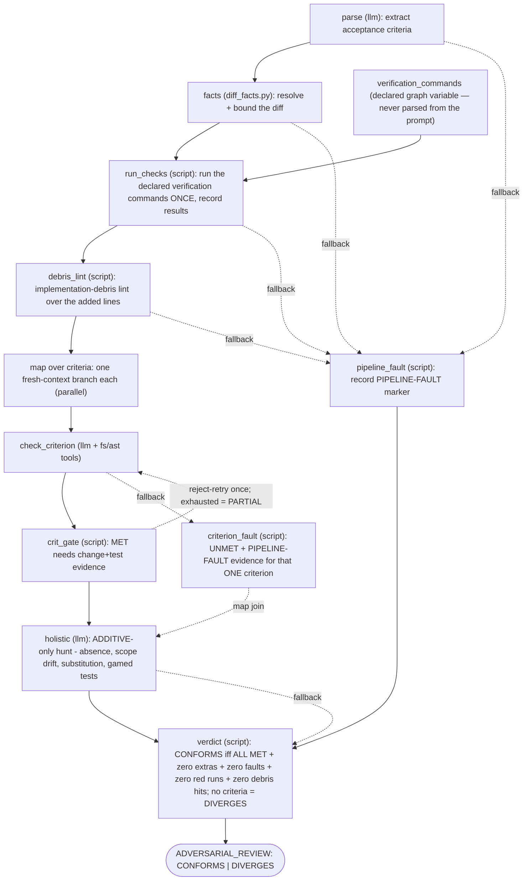

# Adversary

> [!IMPORTANT]
> **v2: now a GRAPH agent.** The plan's acceptance criteria are extracted into a list and the graph
> fans out ONE fresh-context verification branch per criterion — partial coverage ("checked 8 of 12")
> is structurally impossible. Each verdict passes a deterministic contract gate (MET requires
> evidence including a proving test; no test = at best PARTIAL), a holistic ADDITIVE-only pass hunts
> absence/scope-drift/substitution/gamed-tests, and the CONFORMS/DIVERGES sentinel is computed by a
> script (missing plan = DIVERGES, fail-closed). The conformance doctrine below is structurally
> enforced: CONFORMS requires ALL MET + zero holistic complaints + zero pipeline faults +
> zero red verification runs (exit≠0/timeout/skipped, or a runner error when commands were declared).


An **adversarial plan-conformance reviewer**. Where [`code-reviewer`](../code-reviewer/README.md)
asks *"is this code good?"*, `adversary` asks a different, harder question:

> **"Is this the code the plan asked for — all of it, and only it?"**

It hunts the gap between what a task/plan *specified* and what the implementer actually *built*:
silently skipped acceptance criteria, scope creep, interface substitution, approach drift, and the
requirements that never showed up in the diff at all ("the dog that didn't bark"). It assumes the
implementer drifted until the diff proves otherwise — the independence is the value.

## Why it's separate from `code-reviewer`

| | `code-reviewer` | `adversary` |
|---|---|---|
| Question | Is the code correct/clean/safe? | Does the code match the plan? |
| Input | The diff | The diff **+ the plan's acceptance criteria** |
| Blind spot it covers | slop, bugs, coupling, footguns | skipped criteria, scope drift, contract breakage |
| Output | severity-tagged findings (🔴🟡🟢) | a blocking verdict: `CONFORMS` / `DIVERGES` |

They are **complementary passes**, not substitutes. `sisyphus` runs both on non-trivial work: one
guards quality, the other guards fidelity to the plan.

## Verdict (blocking)

The agent ends every review with one sentinel:

```
ADVERSARIAL_REVIEW: CONFORMS
Criteria: N/N met (all with tests).
Debris: clean (N added line(s) scanned)
```

CONFORMS is deterministic: ALL MET + zero holistic complaints + zero pipeline faults +
zero red verification runs (exit≠0/timeout/skipped, or a runner error when commands were declared).
Zero implementation-debris hits from the mechanical `debris_lint` stage are required as well;
the `Debris:` line echoes the lint's summary as evidence that it ran.

```
ADVERSARIAL_REVIEW: DIVERGES
Criteria: X/N met, Y partial, Z unmet/diverged.
Debris: <the lint's summary, or "no summary recorded (the lint did not run)">
Complaints:
1. Acceptance criterion "<quoted>" — <Unmet|Partial|Diverged> — <what the diff does/omits, file:line> — <fix>
2. ...
```

Implementation-debris hits from the deterministic `debris_lint` stage (non-ASCII punctuation on
any added line; planning vocabulary in added prose and comment lines) are numbered complaints of
their own shape and force DIVERGES, with the header noting `N implementation-debris hit(s)`.
Past 25 hits the last complaint carries an `(and N more hit(s) not shown)` note rather than a
numbered complaint of its own:

```
3. Implementation debris -- <path>:<line> -- <rule>: <excerpt> -- fix: <fix>
```

A lint whose shared module cannot be imported, or whose recorded findings cannot be rendered,
is itself one complaint (`Implementation debris lint unavailable: ... -- fail-closed`), never a pass.

Every verdict — CONFORMS or DIVERGES — ends with a `Verification runs:` section: the recorded
PASS/FAIL results (command, exit code, duration, failure tail) of the caller-declared verification
commands, or an explicit marker when none were declared or the run never reached that stage. The
one exception is the verdict script's own crash guard, which emits a bare DIVERGES with a
"verdict computation error" line — and no section — when verdict computation itself dies.

A `DIVERGES` verdict **blocks** completion. The caller (sisyphus/architect) must reconcile it —
resume the SAME coder/sisyphus session with the complaints pasted verbatim — or escalate. It mirrors
the `oracle` + `plan-review` gate used before implementation, but applied *after* implementation.

Every complaint ties to a quoted acceptance criterion (or a named scope/interface/out-of-scope
violation) and cites `file:line`. Vague complaints are not emitted.

## How it reviews



The conformance doctrine is baked into the graph's own nodes:

1. **Every** acceptance criterion gets its own fresh-context verification branch — MET / PARTIAL / UNMET / DIVERGED, machine-gated (MET requires the satisfying change AND the proving test, cited). No test ⇒ at best PARTIAL. Partial coverage of the criteria list is structurally impossible.
2. Ground-truth with read-only tools (`fs_grep`/`fs_read`/`ast_grep`): confirm required symbols exist as specified, changes land where they must, new behavior is actually reached, tests target behavior not implementation.
3. Execution evidence is recorded **once, deterministically**: `run_checks` runs ONLY the caller-declared verification commands (never invented or auto-detected), sequentially under a 3300s total deadline — commands the deadline leaves no budget for are recorded as SKIPPED. Criterion branches have no execution tools by design: "tests pass"-style criteria are judged against the record — a recorded green run is MET citing it; no declared command ⇒ at best PARTIAL. Independently of the criterion judgments, the verdict script blocks CONFORMS on any red run (exit≠0/timeout/skipped) and on an ENVIRONMENT runner-error marker when commands were declared — the declared commands never ran, so the run is unproven. The commands arrive through the declared `verification_commands` graph variable (see [Declaring verification commands](#declaring-verification-commands)) — `parse` never extracts them from the prompt, so the prompt is no longer an extraction source for the commands.
4. Hunt adversarially for the **absent**: skipped criteria, scope creep, interface/approach substitution, out-of-scope touches, downstream contract breakage.
5. **Fail closed on pipeline faults**: if parse, diff resolution, the verification runner, or the debris lint dies, its fallback routes to `pipeline_fault`, which records a `PIPELINE-FAULT:` marker and continues to the verdict (a failed holistic pass falls back straight to the verdict, which synthesizes the same marker). Any recorded fault forces DIVERGES with the fault as complaint #1 -- degraded is never passing, and the sentinel is always emitted: the graph never dies without one.
6. **Fail closed per criterion**: a criterion check that dies (max_iterations exhausted, API failure) falls back to `criterion_fault`, which records a schema-shaped UNMET verdict carrying a `PIPELINE-FAULT: criterion ` evidence marker for that one criterion. The other criteria still get verdicts, the report says the check DIED rather than judged, and the run is DIVERGES. That exact marker prefix (the one `criterion_fault` emits) forces the criterion into unmet regardless of the status it carries, so a verdict that echoes it with `MET` can never count toward CONFORMS; `check_criterion` is told never to begin its own evidence with `PIPELINE-FAULT:`.
7. **Implementation debris is linted mechanically**: `debris_lint` (a thin wrapper over the shared `.shared/debris.py`) re-reads the diff from git and scans every ADDED line for non-ASCII punctuation, and added prose/comment lines for planning vocabulary. Each hit is a DIVERGES complaint, and the report's `Debris:` line carries the lint summary in both verdicts. A line carrying `debris-exempt` is exempt from BOTH rules (a glyph that is the point, or a line that must name the needles); bare `phase N` / `step N` / `round N` are deliberately not needles (too many legitimate uses; the prompt-level rules cover those). Git calls are capped at 30s each and the worst case is bounded (rev-parse or merge-base, up to three diffs under `auto`, one check-attr, and one config lookup per binary driver), inside the 120s node timeout that is the envelope. A lint crash appends its own `PIPELINE-FAULT:` marker (and a node-level kill routes to `pipeline_fault`), so a dead lint never reads as clean. `project_dir` may be any directory inside the repository: the diff always spans the whole repository with root-relative paths (`--no-relative` overrides a `diff.relative` config) and attributes are looked up from the repository top level. A binary marker on a scannable path is triaged by `git check-attr diff`. A `-diff` attribute (`unset`) or a `diff=<driver>` whose `diff.<driver>.binary` is `true` is such a crash: that is text hidden behind a binary marker, and its added lines were not scanned (an unresolved merge in the diff is a crash for the same reason). A path git itself found binary (attribute `unspecified` or `set`, or a driver without that setting) is skipped and named in the summary (`binary skipped: a.bin, b.wasm`; past five names, the count). When a genuine binary sits behind a `-diff` rule or a `binary = true` driver, the remedy is the operator's: add its extension to the skip list in `debris.py` or pass `--exclude` for its directory. Under the review gauntlet the same findings also surface as its `debris` row, which is the authoritative one there. Run it by hand with `python3 assets/agents/.shared/debris.py <project_dir> [diff_spec]` (`diff_spec` defaults to `worktree`, which is `git diff HEAD` and omits untracked files: run `git add -N .` first to include them; exit 1 on hits, 0 when clean, 2 on error; a usage error prints `debris: error: <message>` plus the usage and exits 2); `--exclude <path>` (repeatable; `--` ends the options) leaves a repo-relative literal directory out of the diff, and rejects globs, `.`, absolute paths, pathspec magic (`:`) and `..` segments. In the graph the declared `debris_exclude` variable (default `''`) does the same for the `debris_lint` stage: a JSON array of repo-relative directories as a string (`--agent-variable debris_exclude '["plans"]'`, or the `variables` argument of `agent__spawn`) or one directory name. Empty means none; a value that is neither a string nor a list of strings (`false`, `0`) is rejected rather than read as none, and any invalid value is a lint crash that records a `PIPELINE-FAULT:` marker.

It is **read-only** — it produces a verdict, never a fix.

## Usage

Typically spawned by `sisyphus` (or `architect`) alongside `code-reviewer`. The spawn prompt IS its
entire context, so it must include the diff (or a base ref to fetch) **and** the acceptance criteria.
Verification commands travel separately, as a declared variable:

```sh
agent__spawn --agent adversary --prompt "
## TASK
Adversarially review the recent changes for TASK-NNN against its plan. Return CONFORMS/DIVERGES.

## DIFF
Run get_diff (or --base main), or: <paste diff>

## PLAN — acceptance criteria to check against
<paste the task index.md body + the relevant PLAN-*.md section, verbatim>
" --variables {"verification_commands": "[\"cargo test --all\", \"cargo clippy -- -D warnings\"]"}
```

Direct invocation for ad-hoc use:

```sh
coyote -a adversary --agent-variable project_dir /path/to/repo \
  --agent-variable verification_commands '["cargo test --all"]' \
  "Review staged changes against these criteria: <paste criteria>"
```

### Declaring verification commands

`verification_commands` is a declared graph variable (default `'[]'`): a JSON array of shell
commands, passed as a string because agent variables always arrive as strings. `run_checks` runs
exactly those commands with a shell — so the declaration is a **trust boundary**. The prompt is the
wrong side of it: it also carries plan and diff text pasted from the repo under review, and an LLM
`parse` node extracting commands from that prose would let anything in the repo's text run under
the reviewer's shell. Hence the commands are never in the prompt and never in `parse`'s output
schema; `review-gauntlet` forwards its own `verification_commands` variable to the adversary lane
as a structured `inputs:` passthrough, not as prompt text.

- `'[]'` (or omitted) ⇒ the "none declared" marker; execution criteria are at best PARTIAL.
- Anything that is not a JSON array of strings (unparsable JSON, an object, non-string items) is
  an invalid declaration: `run_checks` executes **nothing** and records a
  `PIPELINE-FAULT: verification_commands declaration invalid — …` marker, which forces DIVERGES:
  it fails closed as a PIPELINE-FAULT (complaint #1) — it never degrades to an ENVIRONMENT marker.
- The engine merges only the keys declared under `parse`'s `output_schema.properties` into state,
  so an injected instruction that makes the parse LLM emit an extra `verification_commands` key
  cannot reach state: the undeclared key is dropped and the declared variable stands.

### Tools

- The graph's `diff_facts` script resolves the diff itself (staged → unstaged → `HEAD~1`, or an explicit ref/range named in the prompt) — there is no `get_diff` tool anymore.
- The `run_checks` script executes the commands declared via the `verification_commands` variable and records the results — criterion branches cite the record and never run anything themselves.
- Criterion branches carry read-only `fs_read`/`fs_cat`/`fs_grep`/`ast_grep` for ground-truth checks.

## Related

- [`code-reviewer`](../code-reviewer/README.md) — the quality reviewer it runs alongside.
- [`plan-review`](../../skills/plan-review/SKILL.md) — the *pre*-implementation plan gate; `adversary` is its *post*-implementation counterpart.
