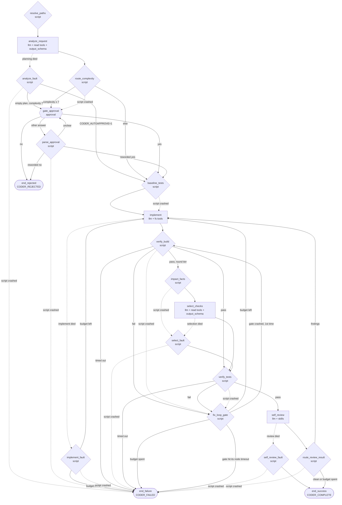

# Coder

A graph-based implementation agent. Plans, implements, and runs build +
tests in a bounded fix-loop until verified. Designed to be delegated to by
the **[Sisyphus](../sisyphus/README.md)** agent.

Coder is a [graph agent](https://github.com/Dark-Alex-17/coyote/wiki/Graph-Agents): its workflow is
defined declaratively in `graph.yaml`, with verification and the
implement-fix loop enforced as graph edges rather than prose.

## Workflow



End nodes emit one of three sentinel outcomes for the caller:

- `CODER_COMPLETE`: the verify gates let the run through (passed, not run,
  or red only in ways the pre-run baseline already recorded).
  Its `Build:`, `Tests:` and `Review:` lines say what each check actually
  did, one line each:
  - `Build: passed`, or `Build: NOT RUN: ...` when no build command was
    configured or detected.
  - `Tests: passed`, `Tests: NOT RUN: ...` when no test command was
    configured or detected, or
    `Tests: red, matches the pre-run baseline (exit <rc>); accepted pre-existing failures: <ids>`
    when the suite failed only in ways the baseline already recorded
    (`unidentified (<reason>)` stands in for the ids when none could be read).
  - `Tier: full`, or in the round tier `Tier: round: targeted <commands>;
    impacted <commands>; ...` naming what ran (see
    [Verify tiers](#verify-tiers)). A `verify_tier` value other than `round`
    or `full` runs the full tier and the line says so.
  - `Review: clean`, `Review: unresolved notes (review budget exhausted):`
    followed by the notes on the next lines, each indented two spaces so no
    note can pass for a report field, or `Review: NOT RUN: ...` when the
    self-review ended without a verdict. `not run` on any of the three means
    the run never reached that check.

  The `Design:` block always comes last.
  Its `Design:` line carries the self-review's `design_notes`: every pattern
  the diff introduced that the repo did not already use (pattern, files, call
  sites touched, one per line, reconciled against the implementer's own
  `Design:` heading), empty when the change only followed precedent or when
  the self-review did not run. It may also carry a `Design: ASK -- <question>`
  line: a restructure beyond the task's scope the implementer could not get
  answered, for the orchestrator to put to the user. An ASK the implementer
  recorded survives even when the self-review did not run: `self_review_fault`
  copies the `ASK --` lines from the implement passes into `design_notes`. A
  disclosure for the orchestrator's report, not a verdict.
  When the suite was already red before the run (see
  [Baseline tests](#baseline-tests)), a `Pre-existing failures: <ids>` line
  follows the `Tests:` line, naming the baseline failures that still fail, a
  `Fixed pre-existing failures: <ids>` line names those that now pass (the
  run exited 0 or its output shows them passing), and a
  `No longer reported failing: <ids>` line names those gone from a red run's
  failures without being shown passing. When the failures could not be
  identified, the line carries the reason instead of ids, e.g.
  `Pre-existing failures: unidentified (no test ids could be parsed), output matches the baseline (exit 1)`
  or `(the runner reported 3 failures but only 2 ids were parsed)`, and a
  baseline whose failures could not be identified that turns green reports
  `Fixed pre-existing failures: unidentified, the suite now passes`.
- `CODER_REJECTED` — user rejected the plan at the approval gate.
  An answer other than exactly `yes` or `no` goes to `parse_approval`: a reworded yes
  (`Yes`, `approve.`, `yes, go ahead`) approves, a reworded no rejects, and
  anything else asks again.
- `CODER_FAILED` — fix-loop exhausted; build/tests still failing — or the
  verification gate crashed twice (see `Verification gate error:`), or
  `route_review_result` / `self_review_fault` / `parse_approval` crashed (see
  `Last script error:`); a crashed `parse_approval` is never read as a
  rejection. A routing script that died has decided nothing, so
  the run does not end as `CODER_COMPLETE` on its behalf. The one gate that
  falls toward a human instead is `route_complexity`: a crash there asks for
  plan approval rather than skipping it.
  A verify gate that ran out of time is not a red run: its
  `Verification gate error:` starts with `verify_build TIMED OUT` /
  `verify_tests TIMED OUT` (killed at `build_timeout` / `test_timeout`) or
  with `TIMED OUT` (killed by the engine at the node timeout), and the run
  ends at once instead of spending fix attempts on code nothing showed broken.

A planning or implement pass that dies (iteration cap, timeout, provider
failure) does not end the run on its own. `analyze_fault` carries on with an
empty plan whose `Plan:` line quotes the error, scored 7 so an interactive run
asks for approval first. `implement_fault` sends implement back to the edits
already on disk, spending one fix attempt per retry; once `max_fix_attempts`
is spent the run ends as `CODER_FAILED` with the error under
`Verification gate error:`.

## Baseline tests

Before `implement` first runs, `baseline_tests` runs the test command once on
the untouched tree (the same command, directory, `test_timeout` and
`build_lock` as `verify_tests`). It never runs again after edits, and it
never ends the run. A red run records its exit code, the failing test ids it
can read from unittest, pytest, cargo, go, jest and vitest output, and a
hash of the failure lines with timings and addresses normalised away. The
`implement` prompt lists those tests under "Tests that already failed before
this run", and fix-loop instructions name them as pre-existing.

The baseline is only taken from a tree known to be untouched, and it is
stored so a later run on the same commit reuses it:

- The record lives at
  `$(git rev-parse --git-common-dir)/coyote-baselines/tests-<key>.json`,
  shared by every linked worktree of the repository, where the
  key is the first 16 hex characters of the sha256 of the HEAD commit, the
  directory relative to the work tree root (`.` for the root) and the test
  command as the gate runs it (after the `--no-fail-fast` rewrite), one per
  line. Only green and red runs are stored, and an existing
  record is never replaced. Records an older version kept under
  `$(git rev-parse --git-path coyote-baselines)` are still read, never
  written.
- A stored record is reused whether or not the tree has changed since; the
  suite is not run again.
- With no record for HEAD on a clean tree and a `baseline_floor` commit set,
  the nearest record on HEAD's first-parent chain (at most 50 commits back)
  is reused when the floor is an ancestor of that record's commit, no merge
  commit lies between it and HEAD, and every commit since was made after the
  record. The note names the record's commit and the commits since. Without
  a floor only HEAD's own record counts. With a floor, failures introduced by
  the calling run's own later commits count as this run's to fix: the record
  taken before them is the baseline. Such a reuse sets
  `baseline_reused_from` to `<record commit>, N commit(s) before HEAD <head>`,
  and the final `Tests:` line names it.
- With no record, the suite runs only when `git status --porcelain` is empty
  (untracked files count, ignored files do not). On a tree that already holds
  changes, `baseline_status` is `dirty` and no baseline is taken, so every
  failing test counts as the run's own.
- Outside a git work tree, before the first commit, when `git status` fails,
  or when a stored record cannot be read, `baseline_status` is `none` and no
  baseline is taken; the note says which.

To retake a baseline, delete its record from that directory.

Cargo ids carry their target (`tests/foo.rs::name`,
`unittests src/lib.rs::name`), jest ids their file (`src/a.test.js > title`).
A failing jest or vitest file with no failing test of its own (a suite that
failed to run) is recorded by its file name. When the runner's own failure
total is higher than the number of ids read, or a cargo test target was
killed by a signal, or cargo stopped at the first failing target, the
failures count as unidentified: some were printed in a form the gate cannot
read or never ran, so only the hash is kept.

Id lists in the `implement` prompt, the fix instructions and the report
lines show the first 20 ids followed by `(+K more)`; the full list stays in
`baseline_failures`.

`verify_tests` then passes a red run only when the suite was already red
and:

- its exit code equals the baseline's (a different code, such as a crash on
  top of the old failures, fails), and
- every failing test it identifies was in the baseline, or, when neither run
  named a test, its failure output hashes the same as the baseline's (output
  with no failure lines hashes to nothing and matches nothing).

Anything it cannot match fails as before: a new failing test, or a run whose
failures cannot be identified against a baseline whose failures could, or a
run in which a test target was killed by a signal. With a green or timed-out
baseline, a `dirty` or `none` one, or a crashed `baseline_tests` (its fallback goes straight to
`implement`), there is no baseline and `verify_tests` judges by the exit code
alone. With no test command `baseline_tests` records no baseline and
`verify_tests` reports `GATE NOT RUN`, which is not evidence that the tests
pass.

A test command that stops at the first failure (pytest `-x`, jest `--bail`,
unittest `--failfast`, `cargo nextest`, which stops at the first failure by
default) defeats the baseline: failures after the first never appear, so a
new one can hide behind an old one. `cargo test` and `cargo t` are run with
`--no-fail-fast` added for the same reason. A wrapper command (`make test`,
`just test`, a script) hides its inner cargo from that rewrite, so a cargo
transcript showing that cargo stopped at its first failing target counts as
unidentified ("cargo stopped at the first failing target").

## Verify tiers

The `verify_tier` variable sets how much each fix-loop lap verifies.

`full` (the default) is the flow described above: a synchronous baseline on
the untouched tree and the whole test command every lap.

`round` keeps each lap short and leaves the whole suite to a finalize gate:

- `baseline_tests` returns at once. It starts the base suite as a background
  job (`.shared/base_suite.py`) in a temporary detached worktree of the base
  commit (`baseline_floor` when it is an ancestor of HEAD, else HEAD), so
  edits in the live tree never reach it and the live tree is never touched.
  The job outlives the node that started it, a second start attaches to the
  running job instead of starting another, and a stored record for the same
  commit, directory and command (including one a `full` run stored) is
  reused. Under `build_lock` the job is only started after `verify_tests` has
  run the lap's selected commands, so it never holds the lock ahead of them.
  The job keeps its state in
  `$(git rev-parse --git-common-dir)/coyote-baselines/jobs/<key>/status.json`
  and writes its record where `full` runs do.
- After `verify_build`, `impact_facts` gathers the changed paths since the
  base, the test files that mention a changed file's stem or sit beside it,
  the full test command with the base suite's duration, and the previous
  lap's selection and result. `select_checks` picks the `targeted` and
  `impacted` test commands from those facts. When either dies,
  `select_fault` selects the full test command and the `Tier:` line quotes
  the error.
- `verify_tests` runs the targeted commands, then the impacted ones, under
  one `test_timeout` and stops at the first red that is not pre-existing. A
  red command is judged against the base suite: its stored record, or the
  running job awaited until the deadline. A narrower command than the full
  suite passes only when it names its failing tests and every one failed at
  the base. A job that died is never restarted: the red command alone is
  re-run at the base instead (`Baseline mode: lazy (background job killed:
  ...)`). A base still running at the deadline leaves the failures
  unclassified, which is red. An empty selection reports `Tests: NOT RUN`.
- Each lap writes a round verification record for the worktree tree under
  `$(git rev-parse --git-common-dir)/coyote-verification/` (see below), and
  the report always ends with `Baseline mode: <mode>`: `background`,
  `reused`, `lazy` or `none`, with ` (pending)` while the job still runs or
  ` (deferred: build_lock)` when it waits for the lock.

Verification records are named `<tree>-<sha16(dir)>-<tier>.json`, where
`<tree>` is the id `git write-tree` gives the worktree as it stands
(untracked, non-ignored files included, built in a copy of the index) and
`<tier>` is `round` or `finalize`. Each lists its results with a role
(`targeted`, `impacted`, `fmt`, `check`, `lint`, `test`) and a verdict
(`green`, `pre-existing`, `red`, `timed_out`, `not_run`). A record is green
when every verdict is `green`, `pre-existing` or `not_run`; a finalize record
also needs a `test` result that is `green` or `pre-existing`. An unreadable
record counts as missing.

`.shared/finalize_gate.sh DIR [WRITER [FLOOR]]` is the finalize gate a
caller runs before it reports done. It runs the detected fmt command, then
puts back the exact earlier bytes of every file fmt rewrote; one that belongs
to the change (the diff from FLOOR, else from the judging base, to the
worktree, plus untracked files) makes the fmt result red with its path. Then
check (`BUILD_CMD` or the detected one), lint (exit 127, a missing linter,
is `unavailable` and never green) and the full test command, each under
`build_lock` and killed after `TEST_TIMEOUT` seconds (default 1800). A red
suite is compared with the base suite record at FLOOR when one is given (run
there on demand when missing); without, with the record for HEAD or the
nearest commit on its first-parent chain (at most 50 back) when no merge and
no commit older than the record separates it from HEAD. A running job is
awaited until its own deadline and the full suite is re-run at the base when
the job died. It writes the finalize record, unless a step timed out or the
status is `unavailable` (a record that decides nothing reads as missing), and prints
`{status: green|red|unavailable, tree, items}`; `unavailable` means nothing
new failed but the suite could not be shown green (no test command, or no
base to compare a red suite with).

Each base suite run gets its own 0700 worktree under
`coyote-baselines/worktrees/` and never sees the agent's `LLM_AGENT_VAR_*`
variables (neither does any gate command run through `run_gate_until`). A
job counts as alive only while its pid exists and its heartbeat is under
five minutes old; a lazy re-run at the base takes the same job claim, and a
run whose worktree vanished stores no record. `base_suite.py cancel --root
DIR` kills every live job started from DIR's worktree and removes its
worktree; step-runner calls it before its own gates.

## Tuning

The agent's `project_dir` is exposed via the standard `variables:` block,
so it accepts the runtime override flag:

```sh
# Invoke from inside the project (project_dir defaults to ".")
cd /path/to/your/project
coyote -a coder "Add a foo() function..."

# Or invoke from anywhere with an explicit override
coyote -a coder --agent-variable project_dir /path/to/your/project "Add..."
```

A parent graph that runs the coder as an agent node can pass
`inputs: project_dir: <path>` instead. `resolve_paths.sh` takes a non-empty
seeded `project_dir` from the graph state over the `project_dir` variable,
because a graph child inherits its parent's variables and the inherited value
may name a different tree (an orchestrator's checkout rather than a task
worktree). With no seeded value the variable is used as before.

A spawned coder whose caller left `project_dir` unset inherits the engine's
working directory, which may be a different checkout from the one it edits.
In that case the verify gates run at the root of the git work tree holding
every absolute file in the plan, provided that tree does not contain the
working directory; each gate's transcript names the directory on its
`Ran in:` line. Passing `project_dir` explicitly is still the reliable form.

`graph.yaml` `initial_state` exposes:

- `max_fix_attempts` (default `5`) — fix-loop budget before `end_failure`.

`graph.yaml` `variables` also exposes:

- `test_command` (default empty): the command `verify_tests` runs instead
  of the detected one, e.g. a targeted `cargo test --test my_suite` when the
  full suite does not fit the deadline. It takes precedence over `TEST_CMD`.
  `baseline_tests` runs the same command, under the same `test_timeout` and
  `build_lock`, so every run with a test command costs one extra suite run
  under the lock, whether or not the suite turns out red; its node has the
  same 3600 s ceiling as `verify_tests`. A baseline that
  times out only means there is no baseline; it never ends the run. Every
  `cargo test` or `cargo t` in the command gets `--no-fail-fast` unless it
  already has it.
- `build_timeout` (default `900`) and `test_timeout` (default `1800`): whole
  seconds each gate may run before it kills the command's whole process
  group and ends the run with a `TIMED OUT` gate error rather than a red
  verdict. `0` disables the deadline. Keep them below the nodes' own
  timeouts (1800 s build, 3600 s tests); a gate the engine kills there is
  also reported as `TIMED OUT`, but its children are not reaped.
- `build_lock` (default empty): command prefix applied to every gate (build
  and tests), e.g. `flock /tmp/coyote-cargo.lock` so parallel agents sharing
  one target directory serialise their gate runs (the coder's own ad-hoc
  cargo calls are not covered). The whole gate command runs under the prefix
  as one unit. Waiting on the lock counts toward the gate's deadline
  (`build_timeout` / `test_timeout`), so prefer `flock -w <secs>` or raise
  those deadlines when runs are long. A gate killed while still waiting can
  leave the lock request queued; `-w` below the deadline makes
  it give up instead of running later unobserved. The prefix is a shell
  fragment and is re-parsed: quote paths containing spaces
  (`flock '/tmp/my lock'`); `$VAR` inside it expands when the gate runs.
  `flock` is util-linux (not shipped on macOS);
  any wrapper that serialises its argument command works.

  ```bash
  coyote -a coder --agent-variable build_lock 'flock -w 240 /tmp/coyote-cargo.lock' "Add..."
  ```

- `baseline_floor` (default empty): the commit a calling run started from.
  It lets `baseline_tests` reuse a record taken on one of that run's own
  earlier commits instead of running the suite again on a later one (see
  [Baseline tests](#baseline-tests)).
- `verify_tier` (default `full`): `full` or `round` (see
  [Verify tiers](#verify-tiers)).

Environment overrides honored by the script nodes:

- `BUILD_CMD` — skip project-type detection for the build/check command.
  Under a `build_lock` prefix the inner shell sees only exported variables;
  a gate command must not depend on the gate script's own locals.
- `TEST_CMD`: skip detection for tests (the `test_command` variable wins).
- `COYOTE_GATE_OUTPUT_MAX_BYTES` — cap on each gate transcript kept in state
  (default 64 KiB; keeps the head ¼ and tail ¾, trimming the middle).
- `CODER_AUTOAPPROVE=1` — bypass the approval gate (for non-interactive runs
  where complexity might trip the gate). Does not cover a crash of
  `route_complexity`, which asks for approval regardless.

## Pro-Tip: IDE MCP Server

Modern IDEs (JetBrains, VS Code, Cursor, Zed, etc.) expose MCP servers
that let LLMs use IDE tools directly. To wire one in, edit `graph.yaml`:

```yaml
mcp_servers:
  - your-ide-mcp-server

global_tools:
  # Keep read-only fs tools for files outside the IDE project
  - fs_read.sh
  - fs_grep.sh
  - fs_glob.sh
#  - fs_write.sh
#  - fs_patch.sh
  - execute_command.sh
```

Then add the MCP server's write/patch tools to the `implement` node's
`tools:` whitelist.
