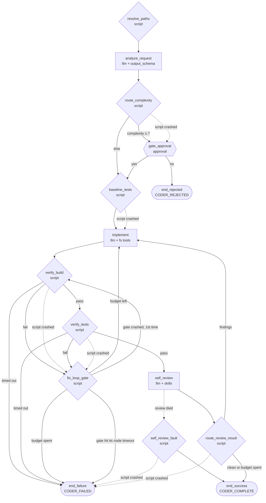

# Coder

A graph-based implementation agent. Plans, implements, and runs build +
tests in a bounded fix-loop until verified. Designed to be delegated to by
the **[Sisyphus](../sisyphus/README.md)** agent.

Coder is a [graph agent](https://github.com/Dark-Alex-17/coyote/wiki/Graph-Agents): its workflow is
defined declaratively in `graph.yaml`, with verification and the
implement-fix loop enforced as graph edges rather than prose.

## Workflow



End nodes emit one of three sentinel outcomes for the caller:

- `CODER_COMPLETE` — build and tests passed.
  Its `Design:` line carries the self-review's `design_notes`: every pattern
  the diff introduced that the repo did not already use (pattern, files, call
  sites touched, one per line, reconciled against the implementer's own
  `Design:` heading), empty when the change only followed precedent or when
  the self-review did not run. It may also carry a `Design: ASK -- <question>`
  line: a restructure beyond the task's scope the implementer could not get
  answered, for the orchestrator to put to the user. An ASK the implementer
  recorded survives even when the self-review did not run: `self_review_fault`
  copies the `ASK --` lines from the implement passes into `design_notes`. A
  disclosure for the orchestrator's report, not a verdict.
  When the suite was already red before the run (see
  [Baseline tests](#baseline-tests)), a `Pre-existing failures: <ids>` line
  follows `Tests: passed`, naming the baseline failures that still fail, a
  `Fixed pre-existing failures: <ids>` line names those that now pass (the
  run exited 0 or its output shows them passing), and a
  `No longer reported failing: <ids>` line names those gone from a red run's
  failures without being shown passing. When the failures could not be
  identified, the line carries the reason instead of ids, e.g.
  `Pre-existing failures: unidentified (no test ids could be parsed), output matches the baseline (exit 1)`
  or `(the runner reported 3 failures but only 2 ids were parsed)`, and a
  baseline whose failures could not be identified that turns green reports
  `Fixed pre-existing failures: unidentified, the suite now passes`.
- `CODER_REJECTED` — user rejected the plan at the approval gate.
- `CODER_FAILED` — fix-loop exhausted; build/tests still failing — or the
  verification gate crashed twice (see `Verification gate error:`), or
  `route_review_result` / `self_review_fault` crashed (see
  `Last script error:`). A routing script that died has decided nothing, so
  the run does not end as `CODER_COMPLETE` on its behalf. The one gate that
  falls toward a human instead is `route_complexity`: a crash there asks for
  plan approval rather than skipping it.
  A verify gate that ran out of time is not a red run: its
  `Verification gate error:` starts with `verify_build TIMED OUT` /
  `verify_tests TIMED OUT` (killed at `build_timeout` / `test_timeout`) or
  with `TIMED OUT` (killed by the engine at the node timeout), and the run
  ends at once instead of spending fix attempts on code nothing showed broken.

## Baseline tests

Before `implement` first runs, `baseline_tests` runs the test command once on
the untouched tree (the same command, directory, `test_timeout` and
`build_lock` as `verify_tests`). It never runs again after edits, and it
never ends the run. A red run records its exit code, the failing test ids it
can read from unittest, pytest, cargo, go, jest and vitest output, and a
hash of the failure lines with timings and addresses normalised away. The
`implement` prompt lists those tests under "Tests that already failed before
this run", and fix-loop instructions name them as pre-existing.

Cargo ids carry their target (`tests/foo.rs::name`,
`unittests src/lib.rs::name`), jest ids their file (`src/a.test.js > title`).
A failing jest or vitest file with no failing test of its own (a suite that
failed to run) is recorded by its file name. When the runner's own failure
total is higher than the number of ids read, or a cargo test target was
killed by a signal, or cargo stopped at the first failing target, the
failures count as unidentified: some were printed in a form the gate cannot
read or never ran, so only the hash is kept.

Id lists in the `implement` prompt, the fix instructions and the report
lines show the first 20 ids followed by `(+K more)`; the full list stays in
`baseline_failures`.

`verify_tests` then passes a red run only when the suite was already red
and:

- its exit code equals the baseline's (a different code, such as a crash on
  top of the old failures, fails), and
- every failing test it identifies was in the baseline, or, when neither run
  named a test, its failure output hashes the same as the baseline's (output
  with no failure lines hashes to nothing and matches nothing).

Anything it cannot match fails as before: a new failing test, or a run whose
failures cannot be identified against a baseline whose failures could, or a
run in which a test target was killed by a signal. With a green or timed-out
baseline, or a crashed `baseline_tests` (its fallback goes straight to
`implement`), there is no baseline and `verify_tests` judges by the exit code
alone. With no test command `baseline_tests` records no baseline and
`verify_tests` reports `GATE NOT RUN`, which is not evidence that the tests
pass.

A test command that stops at the first failure (pytest `-x`, jest `--bail`,
unittest `--failfast`, `cargo nextest`, which stops at the first failure by
default) defeats the baseline: failures after the first never appear, so a
new one can hide behind an old one. `cargo test` and `cargo t` are run with
`--no-fail-fast` added for the same reason. A wrapper command (`make test`,
`just test`, a script) hides its inner cargo from that rewrite, so a cargo
transcript showing that cargo stopped at its first failing target counts as
unidentified ("cargo stopped at the first failing target").

## Tuning

The agent's `project_dir` is exposed via the standard `variables:` block,
so it accepts the runtime override flag:

```sh
# Invoke from inside the project (project_dir defaults to ".")
cd /path/to/your/project
coyote -a coder "Add a foo() function..."

# Or invoke from anywhere with an explicit override
coyote -a coder --agent-variable project_dir /path/to/your/project "Add..."
```

A spawned coder whose caller left `project_dir` unset inherits the engine's
working directory, which may be a different checkout from the one it edits.
In that case the verify gates run at the root of the git work tree holding
every absolute file in the plan, provided that tree does not contain the
working directory; each gate's transcript names the directory on its
`Ran in:` line. Passing `project_dir` explicitly is still the reliable form.

`graph.yaml` `initial_state` exposes:

- `max_fix_attempts` (default `5`) — fix-loop budget before `end_failure`.

`graph.yaml` `variables` also exposes:

- `test_command` (default empty): the command `verify_tests` runs instead
  of the detected one, e.g. a targeted `cargo test --test my_suite` when the
  full suite does not fit the deadline. It takes precedence over `TEST_CMD`.
  `baseline_tests` runs the same command, under the same `test_timeout` and
  `build_lock`, so every run with a test command costs one extra suite run
  under the lock, whether or not the suite turns out red; its node has the
  same 3600 s ceiling as `verify_tests`. A baseline that
  times out only means there is no baseline; it never ends the run. Every
  `cargo test` or `cargo t` in the command gets `--no-fail-fast` unless it
  already has it.
- `build_timeout` (default `900`) and `test_timeout` (default `1800`): whole
  seconds each gate may run before it kills the command's whole process
  group and ends the run with a `TIMED OUT` gate error rather than a red
  verdict. `0` disables the deadline. Keep them below the nodes' own
  timeouts (1800 s build, 3600 s tests); a gate the engine kills there is
  also reported as `TIMED OUT`, but its children are not reaped.
- `build_lock` (default empty): command prefix applied to every gate (build
  and tests), e.g. `flock /tmp/coyote-cargo.lock` so parallel agents sharing
  one target directory serialise their gate runs (the coder's own ad-hoc
  cargo calls are not covered). The whole gate command runs under the prefix
  as one unit. Waiting on the lock counts toward the gate's deadline
  (`build_timeout` / `test_timeout`), so prefer `flock -w <secs>` or raise
  those deadlines when runs are long. A gate killed while still waiting can
  leave the lock request queued; `-w` below the deadline makes
  it give up instead of running later unobserved. The prefix is a shell
  fragment and is re-parsed: quote paths containing spaces
  (`flock '/tmp/my lock'`); `$VAR` inside it expands when the gate runs.
  `flock` is util-linux (not shipped on macOS);
  any wrapper that serialises its argument command works.

  ```bash
  coyote -a coder --agent-variable build_lock 'flock -w 240 /tmp/coyote-cargo.lock' "Add..."
  ```

Environment overrides honored by the script nodes:

- `BUILD_CMD` — skip project-type detection for the build/check command.
  Under a `build_lock` prefix the inner shell sees only exported variables;
  a gate command must not depend on the gate script's own locals.
- `TEST_CMD`: skip detection for tests (the `test_command` variable wins).
- `COYOTE_GATE_OUTPUT_MAX_BYTES` — cap on each gate transcript kept in state
  (default 64 KiB; keeps the head ¼ and tail ¾, trimming the middle).
- `CODER_AUTOAPPROVE=1` — bypass the approval gate (for non-interactive runs
  where complexity might trip the gate). Does not cover a crash of
  `route_complexity`, which asks for approval regardless.

## Pro-Tip: IDE MCP Server

Modern IDEs (JetBrains, VS Code, Cursor, Zed, etc.) expose MCP servers
that let LLMs use IDE tools directly. To wire one in, edit `graph.yaml`:

```yaml
mcp_servers:
  - your-ide-mcp-server

global_tools:
  # Keep read-only fs tools for files outside the IDE project
  - fs_read.sh
  - fs_grep.sh
  - fs_glob.sh
#  - fs_write.sh
#  - fs_patch.sh
  - execute_command.sh
```

Then add the MCP server's write/patch tools to the `implement` node's
`tools:` whitelist.
