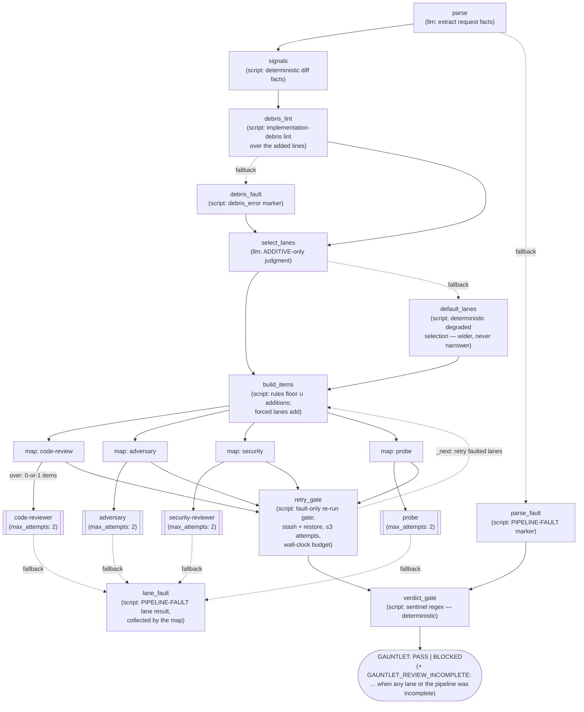

# Review Gauntlet

A graph-based post-implementation review gate — **"the done gate"**. An
orchestrator that must not claim *done* without green reviews spawns this agent
once instead of judging trigger rules and parsing verdict sentinels itself. The
graph structure makes skipping a lane or misreading a verdict impossible:
trigger signals are computed by a script, lanes run as isolated parallel
sub-agents, and the final verdict is a deterministic regex gate — an LLM never
gets the chance to rationalize past it.



## Why a graph

The four independent review lanes existed before this agent — as **prompt
discipline** inside the calling orchestrator: "spawn code-reviewer when the
change is broad", "🔴 always blocks", "INCONCLUSIVE is never PASS". Prompt
discipline degrades under context pressure: a lane gets skipped, a verdict
line gets paraphrased, a missing report reads as "nothing to report". Here
those rules are *structure*:

- **Lane selection floor is deterministic** (`build_items.py`): code-review
  always runs; adversary runs when a spec/plan is present; security runs on
  attack-surface signals (auth/deps/exec paths or diff content) or hardened
  posture; probe runs when consumer-facing surface changed *and* a local-run
  recipe exists. The `select_lanes` LLM can only **widen** the set — a false
  flag never removes a rule-selected lane. `forced_lanes` from the caller
  override everything exactly.
- **Conditional lanes without dynamic routing**: each lane is a `map` node
  over a 0-or-1-item list — an empty list means the map runs zero branches
  (map-over-nothing), which *is* the skip mechanism. All four maps join at
  the retry gate on equal-length paths; it falls through to the verdict
  gate, or routes back to `build_items` for faulted lanes only.
- **The verdict is a regex, not an opinion** (`verdict_gate.py`): a missing
  sentinel is a lane FAILURE, never a pass; the critical count from the
  code-review report's summary line (raw 🔴 count if absent) blocks
  regardless of its verdict line; a code-review lane whose own verdict line
  records a pipeline fault blocks (a degraded review is never a pass); the
  adversary's own degraded-run header (the `Criteria: …` line directly under
  its sentinel recording a pipeline fault, died criterion checks, or its
  verdict script's crash stub) blocks as a pipeline fault,
  not as a DIVERGES finding;
  `NEEDS-HUMAN` without 🔴 passes but
  is surfaced under *Human attention required*; probe `INCONCLUSIVE` blocks
  with an environment note — it is never treated as PASS or FAIL.
- **Implementation debris is linted, not judged** (`debris_lint.py`, over the
  shared `.shared/debris.py`): every ADDED line of the diff is scanned for
  non-ASCII punctuation (dashes, ellipsis, arrows, section signs,
  multiplication and comparison symbols, curly quotes, horizontal bar,
  non-breaking hyphen, minus and almost-equal signs), and prose files plus
  comment-shaped code lines for planning
  vocabulary (task and plan ids, ruling numbers, review-round numbers, lane
  jargon). Any hit is a `debris` row BLOCKED with one blocker per
  finding (`path:line`, rule, excerpt, fix). A crashed lint blocks as a
  PIPELINE-FAULT and names `debris` on the incomplete line -- never a pass;
  a node-level kill routes to `debris_fault`, which writes the same
  `debris_error` marker, and findings in a shape the gate cannot render
  (malformed `debris_findings`) block the same way and name `debris` on the
  incomplete line. The declared `debris_exclude` variable (default `''`)
  leaves directories out of the lint's diff under the same rules as the
  CLI's `--exclude`: a JSON array of repo-relative directories as a string
  (`--agent-variable debris_exclude '["plans"]'`, or the `variables`
  argument of `agent__spawn`) or one directory name. Empty means none; a
  value that is neither a string nor a list of strings (`false`, `0`) is
  rejected rather than read as none, and any invalid value is a lint crash,
  so it blocks.
- **Verdict independence is structural**: lanes run as isolated sub-agents
  with no `teammates:` flag — no cross-lane messaging, by construction.
- **Failure fails closed, structurally** (`fallback:` routes + `PIPELINE-FAULT`
  markers): every LLM node and lane retries once (`max_attempts: 2`), then a
  fallback fires instead of killing the graph — and every fallback degrades
  toward BLOCKED, never toward a pass. A dead lane becomes a `PIPELINE-FAULT:`
  lane result (`lane_fault.py`) that the gate reports as BLOCKED *naming the
  lane* — distinct from SKIPPED (not selected). A dead `parse` records a fault
  and jumps straight to the gate (`parse_fault.py`). A dead `select_lanes`
  degrades to a deterministic selection (`default_lanes.py`): code-review +
  adversary, plus probe on consumer surface *with a local-run recipe*, plus
  security on auth/deps/exec
  signals or hardened posture, unioned with caller-forced lanes — wider, never
  narrower. A crashed `build_items` records a fault so an all-SKIPPED gate
  still blocks. Fault detection is prefix-anchored — a real review that merely
  *quotes* "PIPELINE-FAULT:" flows to the normal sentinel rules. And the
  `GAUNTLET:` sentinel is always emitted: even a crashed gate prints
  `GAUNTLET: BLOCKED`, never silence.

## Fault-only re-runs

`retry_gate.py` sits between the lane maps and the verdict gate and re-runs
only lanes that **faulted** — a missing report (stood in for by a synthetic
`PIPELINE-FAULT: <lane> lane produced no report` marker so it never renders as
SKIPPED), a non-string report, the `lane_fault` marker, a sentinel-less
report, or a nested graph's own degraded-run wording (the code-review verdict
line / the adversary's header line directly under its sentinel). A real verdict
(DIVERGES, FAIL, INCONCLUSIVE, NEEDS-HUMAN, …) is never re-run: the review's
judgment stands. Each lane gets up to 3 attempts, all inside a wall-clock
budget (`MAX_RETRY_ELAPSED_SECS`) sized to fit the graph timeout.

- **Stash + restore**: every lane report that ran this pass is stashed in
  `kept_results`; a re-run pass overwrites the untouched lanes' collected
  results with `[]`, so their stashed reports are restored before the gate.
  The verdict gate always sees each lane's *last* report.
- **Retry never narrows selection**: lane selection is not re-run. A re-run
  pass rebuilds items only for the retried lanes, and the stashed results
  stand in for the rest.
- **Exhaustion is recorded, not hidden**: a lane still faulted after its
  attempts or the budget lands in `review_incomplete`, and its fault flows to
  the verdict gate as-is.
- **Crash guards append**: the `build_items.py` and `retry_gate.py` crash
  guards append to an existing `signals_error` rather than overwrite it, and
  `build_items.py` preserves the prior `lanes_summary`.

A non-empty `GAUNTLET_REVIEW_INCOMPLETE:` line structurally implies
`GAUNTLET: BLOCKED`: the verdict gate forces every lane named in
`review_incomplete` to a BLOCKED row (`review incomplete after N attempt(s)`)
and a matching blocker, so a restored earlier report can never turn an
incomplete review into a pass — and malformed `review_incomplete` bookkeeping
is itself recorded as a `pipeline` fault, never dropped.

Whenever at least one lane (or the pipeline) could not complete, the first
line reads `GAUNTLET: BLOCKED` followed immediately by
`GAUNTLET_REVIEW_INCOMPLETE: <lane>[, <lane>]`. The names are the exhausted
lanes from `review_incomplete`, plus the `pipeline` pseudo-lane whenever a
pipeline-level `PIPELINE-FAULT:` fired — parse death, or a crash in the
builder, the retry gate, the default-lanes fallback, or the verdict gate
itself (the default-lanes fallback's crash still runs the widened lanes, so
`pipeline` appears alongside real lane rows), plus `debris` when the lint
crashed, was killed, its module could not be imported, or its findings
arrived malformed. The report gains a
`## Review incomplete` section naming each exhausted lane with its
attempt count; `PIPELINE-FAULT` lane rows carry ` ×N` when the lane was
re-run (N > 1). The *named* entries are faults to re-run, never code
findings; the line can accompany real findings from the other lanes, which
still appear under `## Blockers` and must be fixed as usual.

## Sentinels parsed

| Lane | Sentinel | Blocks on |
|------|----------|-----------|
| code-reviewer | `**Verdict: MERGE-READY \| NEEDS-HUMAN**` | critical count from the report's summary line (raw 🔴 count if absent); missing sentinel; own verdict line records a pipeline fault |
| adversary | `ADVERSARIAL_REVIEW: CONFORMS \| DIVERGES` | DIVERGES; own degraded-run header (pipeline fault, died criterion checks, or its verdict script's crash stub); missing sentinel |
| security-reviewer | `SECURITY_REVIEW: PASS \| FAIL` (whole line only; the last such line wins -- a sentinel quoted inside the body is not read; a sentinel followed by text on the same line is treated as missing and re-runs the lane) | FAIL; missing sentinel |
| probe | `USAGE_PROBE: PASS \| FAIL \| INCONCLUSIVE` (whole line only; the last such line wins -- a sentinel quoted inside the body is not read; a sentinel followed by text on the same line is treated as missing and re-runs the lane) | FAIL; INCONCLUSIVE (environment note); missing sentinel |
| debris | none -- `debris_lint.py` findings read directly from state | any non-ASCII-punctuation or planning-artefact hit on an added line; a crashed lint (PIPELINE-FAULT, `GAUNTLET_REVIEW_INCOMPLETE: debris`) |

## Spawning it

```
agent__spawn --agent review-gauntlet --prompt "Post-implementation review gate.

Project: /abs/path/to/repo
Diff: main...HEAD          (a git range, a ref, or 'worktree' for uncommitted changes)
Rigor: production          Security posture: standard

Plan / acceptance criteria:
<paste the criteria the implementation must satisfy — enables the adversary lane>

Local-run recipe / usage suites:
<how to boot the service locally + where existing suites live — enables the probe lane>

Forced lanes: (optional, ADDITIVE — e.g. 'adversary, probe' run on top of the computed selection; forcing never drops the always-on floor)" \
  --variables {"verification_commands": "[\"cargo test --all\", \"cargo clippy -- -D warnings\"]"}
```

### Re-review rounds: delta-narrowed lane selection

On a re-review spawn (after fixing a prior round's findings), two optional
prompt lines let the gauntlet skip lanes the fix provably cannot affect
instead of re-running everything:

```
Re-review delta: <bare SHA of HEAD when the prior round ran, or an explicit range like abc1234..HEAD>
Settled lanes: <bare lane names only, comma-separated, e.g. 'security, probe' (or 'none')>
```

The rules (all deterministic; the lines are split in `signals.py`, judged in
`build_items.py`):

- **Bare lane names only.** The `Settled lanes:` line is a comma/space
  separated list of `code-review`, `adversary`, `security`, `probe` (the
  aliases in `build_items.ALIASES` are also accepted) or `none`; no verdicts,
  round notes or parentheticals. A leading `none` makes the rest of the line
  a comment (`none (nothing was green)` settles nothing). Otherwise one
  unrecognised token refuses the whole line: nothing narrows, and the Lane
  selection section records `settled lanes ignored: unrecognised token '<t>'
  (bare lane names only)`.
- A settled lane is skipped **iff the delta alone would not have selected it
  under the same hard rules**: `security` skips when the delta has no
  auth/deps/exec signals (and posture isn't hardened); `probe` skips when the
  delta touches no consumer-facing surface; `adversary` skips only when the
  delta is docs-only — a fix that touches tests always re-runs adversary,
  since its whole job is checking the tests prove the acceptance criteria.
  `code-review` is never narrowed.
- **Settled means green.** List a lane only when its prior verdict was green
  (code-review PASS with 0 criticals / adversary CONFORMS / security PASS /
  probe PASS). A lane that found problems is not settled — leave it off and it
  re-runs to verify the fix.
- **Fail-open everywhere**: no delta line, an unusable range, a failed delta
  diff, or unavailable primary signals → narrowing is disabled and the full
  selection runs. The `select_lanes` judgment can VETO a skip by re-adding the
  lane (its flags are additive), and `Forced lanes:` resurrects anything.
- The delta only exists when fixes landed as commits — a bare prior-round HEAD
  SHA works (it is diffed from its merge-base with HEAD). Rounds reviewing
  uncommitted `worktree` changes cannot narrow.

Skipped lanes show as SKIPPED in the lane table with the narrowing reason in
the Lane selection section; the prior round's green verdict remains the
caller's evidence for those lanes.

Verification commands are NOT part of the prompt. They are the declared
`verification_commands` graph variable (default `'[]'`; a JSON array of shell
commands as a string, since agent variables arrive as strings), also settable
from the CLI:

```sh
coyote -a review-gauntlet --agent-variable project_dir /abs/path/to/repo \
  --agent-variable verification_commands '["cargo test --all"]' "<prompt>"
```

The reply opens with `GAUNTLET: PASS` or `GAUNTLET: BLOCKED` (plus the
`GAUNTLET_REVIEW_INCOMPLETE:` line when applicable), followed by a lane status
table, the lane-selection reasons, blockers, attention items, and each lane's
full report in a collapsible section. On BLOCKED with a
`GAUNTLET_REVIEW_INCOMPLETE:` line: the named lanes never completed — this is an
infrastructure fault, never a code finding. Fix any non-fault blockers listed
under `## Blockers` first (the re-run retries the lane); if the line persists,
escalate to the user with three options — retry the review again (a **fresh**
gauntlet run), accept NEEDS-HUMAN and proceed without that lane (recorded in the
report / PR body), or abort — never route it through your findings-handling
rules. On BLOCKED without it: fix the findings per your own findings-handling
rules, then spawn a **fresh** gauntlet run. On PASS with *Human attention
required*: complete the work but carry those items into your final report
verbatim.

## Notes

- The caller decides *whether* review is warranted at all (the gauntlet is for
  non-trivial work — that's why code-review is unconditionally on); the
  gauntlet decides *which* of the other lanes apply and what the verdicts mean.
- Lane sub-agents get generous finite per-attempt timeouts (see the
  `timeout:` on each `run_*` node) and one retry (`max_attempts: 2`) inside
  the lane, then up to 3 attempts of the whole lane from `retry_gate.py` while
  the wall-clock budget (`MAX_RETRY_ELAPSED_SECS`) allows; `settings.timeout`
  is derived from that envelope in graph.yaml's comment. A lane that still
  dies or times out falls back to the `lane_fault` marker — BLOCKED naming the
  lane and `GAUNTLET_REVIEW_INCOMPLETE`, never a silent pass.
- The `verification_commands` variable is forwarded to the adversary lane as a
  structured `inputs:` passthrough on `run_adversary` (a lone `{{…}}` template
  lands the raw value in the child's state) — never through the lane prompt
  and never extracted by `parse`. The adversary's `run_checks` stage executes
  those commands with a shell, which makes the declaration a trust boundary:
  the prompt also carries plan text pasted from the repo under review, so
  commands must never be inferred from it, and the engine merges only the keys
  `parse`'s `output_schema.properties` declares, so an extra
  `verification_commands` key emitted by the LLM is dropped before it reaches
  state.
  Undeclared stays undeclared
  (`'[]'` ⇒ "none declared"); a declaration that is not a JSON array of
  strings executes nothing and records a `PIPELINE-FAULT`, which the
  adversary lane reports as DIVERGES and the gate as BLOCKED.
- The `build_lock` variable (default empty) rides the same `inputs:`
  passthrough: when set, `run_checks` runs each declared command as one unit
  under that prefix (e.g. `flock -w 240 /path/to/lock`), the same way the coder and
  step-runner gates do, so a parallel batch sharing one target directory
  serialises its verification runs too.
- Signals failures degrade WIDER: if git can't compute the diff, the surface
  is unknown — the security lane is added (and probe, when a local-run recipe
  exists) on top of caller context + forced lanes, and the report notes it.
- The auth-path regex deliberately over-fires (`auth(?!or(?!i[sz]))` matches
  auth/authn/authz/oauth/authorize/authorise but not "author") -- the safe
  direction, since signals only ever ADD the security lane.
- The `debris` lint counts a MOVED line as added: touching a line means
  leaving it ASCII (a `--` for an em dash, `...` for an ellipsis, `->` for an
  arrow). A glyph that is the point (box drawing in a renderer, a pinned spec
  title) or a line that must name the needles themselves is spared by putting
  the token `debris-exempt` on that line, which exempts it from BOTH rules;
  the report counts exemptions. Bare `phase N` / `step N` / `round N` are
  deliberately not needles (too many legitimate uses); the prompt-level
  rules cover those. The adversary lane runs the same lint and reports
  hits as DIVERGES complaints; when both fire, the gauntlet's `debris` row is
  the authoritative one. Skipped: `fixtures/`, `vectors/`, `corpus/`,
  `snapshots/`, `testdata/` paths, and the `.lock`, `.svg`, `.snap`, `.pdf`,
  `.png`, `.jpg`, `.jpeg`, `.gif`, `.ico`, `.woff`, `.woff2`, `.ttf`, `.otf`
  extensions; any other file git itself reports as binary is skipped and
  named in the summary (`binary skipped: a.bin, b.wasm`; the count when
  there are more than five).
  The lint checks glyphs and vocabulary only; the docs-voice checklist (a
  page that assumes no prior knowledge, says what it is for up front, reads
  as a guide) is applied by the probe lane when that lane is selected, and
  a docs-only diff is covered by the code-review skill's
  comments-and-documentation section.
  Run the lint by hand before spawning the gauntlet:

  ```sh
  python3 assets/agents/.shared/debris.py <project_dir> [diff_spec]
  python3 assets/agents/.shared/debris.py --exclude plans <project_dir> <merge-base>
  ```

  `diff_spec` defaults to `worktree` (`git diff HEAD`, which omits untracked
  files: run `git add -N .` first to include them) and accepts the
  gauntlet's dialect (`X..Y`, `X...Y`, a bare ref from its merge-base) plus
  the adversary's `staged` and `auto`; the gauntlet's own `Diff:` line only
  knows `worktree`, ranges and bare refs. Prints one line per hit and the
  summary; exit 1 on hits, 0 when clean, 2 on error (option-shaped specs are
  rejected). `--exclude <path>` (repeatable; `--` ends the options) leaves a
  repo-relative literal directory out of the diff, for a hygiene pass that
  may name its own plan tree; globs, `.`, absolute paths, pathspec magic
  (`:`) and `..` segments are errors, since excluding the whole tree would
  print the same clean summary an unchanged tree does. A usage error prints
  `debris: error: <message>` plus the usage and exits 2. `project_dir` may
  be any directory inside the repository: the diff always spans the whole
  repository with root-relative paths (`--no-relative` overrides a
  `diff.relative` config), and attributes are looked up from the repository
  top level. A binary marker on a scannable path is triaged by
  `git check-attr diff`. A `-diff` attribute (`unset`) or a `diff=<driver>`
  whose `diff.<driver>.binary` is `true` is an error: that is text hidden
  behind a binary marker, and its added lines were not scanned (an
  unresolved merge in the diff is an error for the same reason). A path git
  itself found binary (attribute `unspecified` or `set`, or a driver without
  that setting) is skipped and named in the summary (`binary skipped: a.bin,
  b.wasm`; past five names, the count). When a genuine binary sits behind a
  `-diff` rule or a `binary = true` driver, the remedy is the operator's:
  add its extension to the skip list in `debris.py` or pass `--exclude` for
  its directory. Git calls are capped at 30s each and the worst case is
  bounded (rev-parse or merge-base,
  up to three diffs under `auto`, one check-attr, and one config lookup per
  binary driver), inside the 120s node timeout that is the envelope (a kill
  routes to `debris_fault`). Findings are capped at 200 per run; the summary
  says how many were kept.
- Requires the `code-reviewer`, `adversary`, `security-reviewer`, and `probe`
  agents to be installed (they ship with Coyote).
