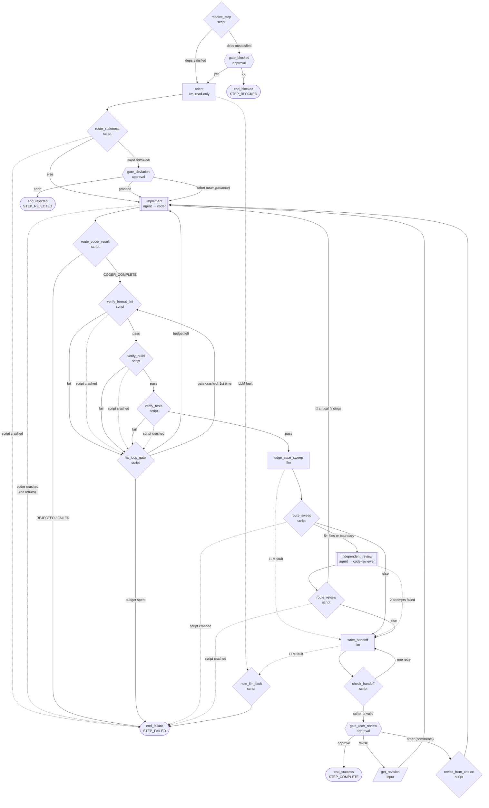

# Step-Runner

A graph-based agent that executes **one step** of a phased implementation
plan, with the step protocol from the `step-implementation` skill enforced
as graph edges rather than prose. Designed to be delegated to by
**[Sisyphus](../sisyphus/README.md)**; delegates implementation to
**[Coder](../coder/README.md)** and independent review to
**[code-reviewer](../code-reviewer/README.md)**.

It expects a plan repo authored per the `plan-authoring` skill:

```
plans/
  steps/NN-<slug>.md    # step plans with frontmatter (step/title/depends_on/status)
  handoffs/NN-<slug>.md # written by this agent, validated by a deterministic gate
  NOTES.md              # rolling durable facts
```

## Workflow



End nodes emit sentinel outcomes for the caller:

- `STEP_COMPLETE` — step implemented, verified, handoff written, user approved.
  The coder's `Design:` block (a pattern new to this repo it introduced inside
  the new code) is carried into the handoff and returned under a
  `Design decisions:` heading, empty when the coder followed precedent; a
  `Design: ASK` line is surfaced as a question at the approval gate instead.
- `STEP_BLOCKED` — `depends_on` unsatisfied and the user declined to proceed.
- `STEP_REJECTED` — user aborted at the deviation gate, or the coder's plan
  was rejected at its approval gate.
- `STEP_FAILED` — the coder failed or crashed, the step-level fix budget was
  exhausted, a verification gate crashed twice (rendered as `Verification
  gate error:`), the handoff failed validation twice, or an orient/handoff
  LLM fault was recorded (rendered as `Pipeline fault:` in the output), or a
  routing gate (`route_staleness`/`route_sweep`/`route_review`) crashed
  (rendered as `Last script error:`).

The edge-case sweep also derives the step's debt list mechanically rather
than trusting the coder's summary: after `git ls-files --others
--exclude-standard -z | xargs -0 -r git add -N --` (so every file the coder
created counts, listed or not, while `.gitignore` keeps build artefacts out)
it greps the step diff's added lines for `#[allow(`, `#![allow(`, `#[expect(`,
`#![expect(`, `cfg_attr(`, `todo!`, `unimplemented!` and `#[ignore` (a
`cfg_attr(` hit carrying neither `allow` nor `expect` is dropped), plus any
env-gated or opt-in test. A marker
with no same-line comment naming its owning task is a finding; since the
sweep has no edge back to the coder, it lists each one under
`Debt left behind:` in the handoff's Notes for next step and in the
approval-gate summary, where the user can send the step back for revision.

## Fault handling

Node crashes degrade the run visibly instead of masquerading as success:

- `implement` has **no retries** — rerunning a coder that died mid-edit
  against an already-mutated tree is unsafe. Its failure text lands in
  `coder_result` and the run falls straight to `end_failure`.
- `independent_review` retries once (`max_attempts: 2`); if both attempts
  fail it falls back to `write_handoff`, which flags "PIPELINE-FAULT:
  independent review did not run" in the handoff rather than presenting the
  failure text as findings. `route_review` carries the same guard before its
  🔴 grep, so a reviewer fault never spends a fix-loop attempt.
- `edge_case_sweep` faults likewise fall through to `write_handoff` and are
  flagged as "PIPELINE-FAULT: edge-case sweep did not run".
- `verify_format_lint`, `verify_build` and `verify_tests` crashes (not
  failures — the script itself died) take their fallback edge to
  `fix_loop_gate`, which re-runs verification once per cycle without spending
  a fix attempt; a second crash ends as `STEP_FAILED` with the engine's error
  under `Verification gate error:`.
- `route_staleness`, `route_sweep` and `route_review` crashes end as
  `STEP_FAILED` with the engine's error under `Last script error:`. A routing
  gate that died has decided nothing, so the run does not proceed as if it
  had chosen the optimistic branch.
- `orient` and `write_handoff` faults route through `note_llm_fault`, which
  distills the engine's failure text into a `fault_note` rendered in the
  `STEP_FAILED` output — never an empty shell.

Degraded is never passing (a skipped review or sweep is recorded as NOT RUN,
never paraphrased as covered), and the sentinel is always emitted — every
path terminates at one of the four end nodes, so the caller always gets a
parseable outcome.

## Usage

```sh
# From the project root: run the next in-progress/pending step
coyote -a step-runner "Execute the next step"

# A specific step (also parsed from the prompt: "execute step 3")
coyote -a step-runner --agent-variable step 3 "Execute step 3"

# Plan repo somewhere else
coyote -a step-runner --agent-variable plans_dir docs/plans "Execute the next step"

# Serialise the gates with other agents sharing the target directory
coyote -a step-runner --agent-variable build_lock 'flock -w 240 /tmp/coyote-cargo.lock' "Execute the next step"
```

**Invoke from the project root.** The coder sub-agent resolves its own
`project_dir` from the invocation directory; overriding `project_dir` here
does not propagate to the spawned coder.

## Tuning

`graph.yaml` `initial_state` exposes:

- `max_fix_attempts` (default `2`) — step-level fix budget (the coder has
  its own internal budget of 5).
- `max_review_attempts` (default `1`) — bounded 🔴-finding fix loops after
  independent review.

`graph.yaml` `variables` also exposes:

- `build_lock` (default empty): command prefix applied to every gate
  (format, lint, build and tests), e.g. `flock /tmp/coyote-cargo.lock` so
  parallel agents sharing one target directory serialise their gate runs
  (the spawned coder's own gates inherit the prefix: parent agent variables
  are cloned into the child; its ad-hoc cargo calls are not covered). The
  whole gate
  command runs under the prefix as one unit. Waiting on the lock counts
  toward the gate node's timeout (300 s format/lint, 600 s build, 1200 s
  tests), so prefer `flock -w <secs>` or raise those timeouts when runs are
  long. A gate killed by its timeout while still waiting leaves the lock
  request queued; `-w` below the node timeout makes it give up instead of
  running later unobserved. The prefix is a shell fragment and is re-parsed:
  quote paths containing spaces (`flock '/tmp/my lock'`); `$VAR` inside it
  expands when the gate runs.
  `flock` is util-linux (not shipped on macOS); any wrapper that
  serialises its argument command works.

Environment overrides honored by the script nodes:

- `FORMAT_CMD` / `LINT_CMD` — formatting and linting (otherwise a per-type
  heuristic formats, and linting defers to the build/check command).
- `BUILD_CMD` / `TEST_CMD` — skip project-type detection (same as coder).
- The `test_command` graph variable: the test gate runs this instead of the detected command (`TEST_CMD` still wins). Use it for a project whose full suite does not fit the gate's timeout: hand the gate a targeted command and leave the full suite to the review.
  Under a `build_lock` prefix the inner shell sees only exported variables;
  a gate command must not depend on the gate script's own locals.
- `COYOTE_GATE_OUTPUT_MAX_BYTES` — cap on each gate transcript kept in state
  (default 64 KiB; keeps the head ¼ and tail ¾, trimming the middle).
- `STEP_AUTOAPPROVE=1` — bypass the deviation gate (non-interactive runs).
- `STEP_SKIP_REVIEW=1` — never spawn the independent reviewer.

The final user approval gate is never bypassed by an environment variable -
it is the point of the workflow.
